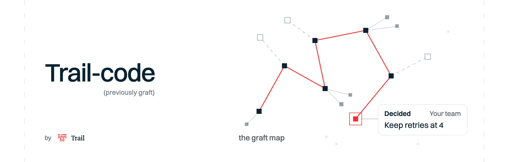
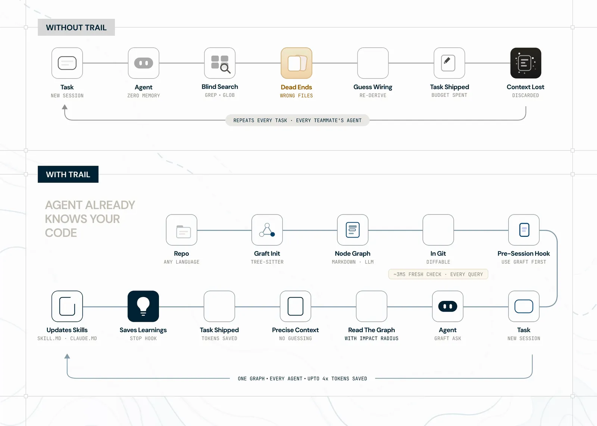

> **[中文化] Trail-Code**
>
> 此项目是 [trailhq/Trail-Code](https://github.com/trailhq/Trail-Code) 的中文翻译版本。
> - 原项目 Stars: 10487
> - 主语言: TypeScript
> - 许可证: MIT
> - 翻译日期: 2026-10-21
> - 原始 README: [README_en.md](README_en.md)
>
> 说明：下方 README 正文为**原项目文档的中文翻译**，力求忠于原文；本页顶部的「中文快速上手」为**面向中文用户的补充导读**（非原文内容），目的是让你不用读完整篇 README 就能先把项目跑起来。
>
> 如有翻译不准确之处，欢迎提 Issue 或 PR。

---


## 🚀 中文快速上手（补充导读，非原文）

### 这是什么 / 解决什么问题

Trail-code（原名 graft）是给编码智能体（Claude Code、Cursor、Codex 等）用的「自学习上下文层」。它做两件事：一是为你的代码建一张「graft map」——索引每个函数以及谁调用了它，让智能体直接找到正确的文件、并知道改动可能影响什么；二是记录你、你的智能体和团队在对话中形成的「learnings」（决定、排除过的方案、注意事项），让智能体接着上次的进度干，而不是每次从零摸索。README 给出的数据是：162 次运行中工具调用减少 46%、耗时减少 60%，SWE-bench Verified 50 个真实 issue 上解出 33 个（不用时为 27 个）。

### 快速上手（最短路径）

1. 全局安装（README 首页给出的命令）：
   ```bash
   npm install -g @trailhq/trail-code
   ```
2. 在仓库中初始化，构建 graft map：
   ```bash
   trail init
   ```
3. 之后用你惯用的编码智能体在该仓库里工作即可——README 说明 `trail init` 会建好 graft map，并通过 hook 在每次会话前把智能体指向它（具体 hook 配置方式原文未说明）。
4. 提交 PR 前可运行 `trail check`，它会标出与团队既有决定冲突的改动（原文提到此命令，但完整用法原文未说明）。
5. 其余命令（如 `trail grep`、`trail map`、`trail viz`）在 README 的 Reference 章节有介绍，本材料未展开，请参考 README 正文。

### 环境要求

- **操作系统**：原文未明确列出支持的系统；Dockerfile 使用 `node:22-bookworm-slim`（Debian）作为构建基础镜像。
- **Node.js**：`package.json` 的 `engines` 要求 `node >= 20`。
- **依赖**：安装过程会通过 node-gyp 从源码编译 tree-sitter 语法（Dockerfile 注释提到「九个 tree-sitter 语法」），因此需要可用的编译工具链（如 Python、C++ 构建工具）；Dockerfile 注释明确指出 slim 镜像缺少工具链会导致失败。
- **硬件**：原文未说明。
- **网络**：npm 全局安装涉及从 npm registry 下载包及原生依赖编译，国内网络环境可能需要更换 npm 镜像源或配置加速。

### 常见坑与注意事项

- **需要编译原生模块**：安装时会从源码构建 tree-sitter 语法，缺少 node-gyp 所需工具链（Python、编译器）会安装失败。
- **Node 版本下限**：必须 Node.js 20 及以上，低版本无法运行。
- **命令名与包名不一致**：npm 包名是 `@trailhq/trail-code`，但可执行命令是 `trail`；`package.json` 中另保留了 `graft` 作为 bin 入口，README 也说明旧的 `graft` 命令仍然可用。
- **遥测**：README 徽章标注 telemetry 为「anonymous, opt-out」（匿名、可关闭），细节见仓库的 `TELEMETRY.md`，原文未在本材料中展开。

---


---

<div align="center">

<picture>
  <source media="(prefers-color-scheme: dark)" srcset="assets/trail-code-banner-dark.png">
  
</picture>

### 面向编码智能体的自学习上下文层。

Trail-code 为 Claude Code、Cursor、Codex 等编码智能体提供一张代码地图，以及团队对这份代码的所学所得。

| | 代码地图（原 graft） | 经验 |
|---|---|---|
| **是什么？** | 代码索引：每个函数及调用方，让智能体看到改动可能破坏什么 | 你、你的智能体和团队学到并决定的内容 |
| **对智能体有什么用？** | 直接带它到正确的文件 | 让它从你和团队停下的地方继续 |
| **从哪来？** | 你的代码，在本机读取 | 你的对话，边工作边记录 |

<a href="https://trendshift.io/repositories/92209?utm_source=trendshift-badge&utm_medium=badge&utm_campaign=badge-trendshift-92209" target="_blank" rel="noopener noreferrer"></a>

<p>
  <a href="https://github.com/trailhq/Trail-Code"></a>
  <a href="https://trailhq.com/graft"></a>
  <a href="https://discord.gg/zxmKweAA29"></a>
  <a href="https://www.npmjs.com/package/@trailhq/trail-code"></a>
  <a href="https://www.npmjs.com/package/@nanonets/graft"></a>
  <a href="https://nodejs.org"></a>
  
  
  <a href="TELEMETRY.md"></a>
  <a href="https://scorecard.dev/viewer/?uri=github.com/trailhq/Trail-Code"></a>
</p>

### **工具调用减少 46%**，**耗时减少 60%**，解决的真实问题更多。

| | 冷启动智能体 | 使用 graft 地图的智能体 |
|---|---|---|
| 工具调用，162 次运行 | 基线 | **减少 46%** |
| 未缓存输入 token，162 次运行 | 基线 | **减少 42%** |
| 耗时，162 次运行 | 基线 | **减少 60%** |
| SWE-bench Verified，50 个真实 Issue | 解决 27 个（54%） | **解决 33 个（66%）** |

```bash
npm install -g @trailhq/trail-code && trail init
```

</div>

> [!NOTE]
> **Graft 现已更名为 Trail-code。** Graft 作为 graft 地图继续存在，所有 `graft` 命令仍然可用。新增的是经验功能。[变更说明](#coming-from-graft)

<p align="center">
  <picture>
    <source media="(prefers-color-scheme: dark)" srcset="assets/trail-code-how-it-works-dark.webp">
    
  </picture>
</p>

---

## 你的智能体会有什么变化

| 没有 Trail-code | 有 Trail-code |
|---|---|
| 用 grep 逐个打开文件，寻找所需代码 | 随提示词直接获得正确的文件和函数 |
| 重新探索队友上周已经弄清楚的代码 | 从他们的经验出发：决定了什么、排除了什么、要注意什么 |
| 推翻队友的决策，因为从不知道它存在 | `trail check` 在 PR 前标记出来，并引用是谁、为何这样决定 |
| 到合并时才发现队友改了同一处代码 | 编辑了队友未合并分支也在改的代码后立即告知，并说明两者是否冲突 |
| 每次会话都要重复交代同样的事 | 从你之前说过的内容出发：`trail init` 找出你在过去会话中说过多次的内容 |
| 手动编写和更新 CLAUDE.md | 经验从你的对话中保存，存为可读的文件 |

**同样的模型，解决更多任务。** 在 SWE-bench Verified（真实 GitHub Issue，由维护者自己的测试评分）上，Claude Sonnet 5 使用 graft 地图解决了 **50 个中的 33 个**，不用时解决 **50 个中的 27 个**，且 token 用量减少 23%。[详情](#swe-bench-verified)

**更便宜、更快。** 同一智能体在同一任务上的 162 次运行：**成本降低 32%**、**未缓存输入 token 减少 42%**、**耗时减少 60%**，正确率持平。在 PocketBase 上，15 个真实任务**成本降低 21%**、**速度提升 14%**。[详情](#benchmark)

---

## 目录

- [工作原理](#how-it-works)
- [快速开始](#quick-start)
- [第 1 部分：graft 地图](#part-1-the-graft-map)，你的代码
- [第 2 部分：经验](#part-2-learnings)，你、你的智能体和团队所知
  - [四种类型，三个位置](#four-kinds-three-places) · [一个决策，两位队友](#one-decision-two-teammates) · [经验即文件](#a-learning-is-a-file) · [智能体负责保存](#your-agent-does-the-saving)
- [你的团队](#your-team)
- [哪些数据留在本机](#what-stays-on-your-machine)
- [基准测试](#benchmark) · [SWE-bench Verified](#swe-bench-verified) · [在热门仓库上测试](#tested-on-popular-repos)
- [FAQ](#faq)
- 参考：[图如何构建](#how-the-graph-gets-built) · [支持的语言](#supported-languages) · [节点内容](#whats-in-a-node) · [哪些在本机运行](#what-runs-where) · [智能体集成](#agent-integration) · [CLI](#cli) · [搜索与定位](#search--orient-trail-grep--trail-map) · [Monorepo](#monorepos-submodules--multi-repo-folders) · [可视化](#visualize-it-trail-viz) · [开发](#development)

---

## 工作原理

Trail-code 有两个部分，都在你的机器上运行。

1. **graft 地图：你的代码。** `trail init` 用 tree-sitter 解析仓库，生成每个文件、函数及调用关系的图。无需模型，无需 API key。代码变化时自动刷新，包括未提交的修改。每次提示词都会给智能体指向匹配的文件和函数；编辑文件后立即看到哪些代码依赖它。
2. **经验：你、你的智能体和团队所知。** 会话弄清了某件事，或你纠正了某种做法，智能体将其保存为经验。下次处理该代码的会话（你的或队友的）从它出发，无需重新挖掘。关于代码的经验随代码提交；关于你的经验留在本机。第一天，`trail init` 会用你在过去会话中多次告诉 Claude 的内容，以及审查者在仓库多个已合并 PR 上标记的问题，为你起步。

graft 地图告诉智能体东西*在哪*。经验告诉它*为什么*是这样，以及*这里的工作怎么做*。

---

## 快速开始

```bash
npm install -g @trailhq/trail-code   # 安装 CLI，一次即可
trail init                      # 在仓库中：构建 graft 地图，设置 .trail/，接入智能体
```

这就是全部设置。`trail init` 询问要接入哪些编码智能体，从代码构建 graft 地图，创建 `.trail/` 存放仓库经验，并为 Claude Code 添加状态栏和 Hook。它还会读取你在该仓库的过往 Claude Code 会话，找出你多次告诉 Claude 的内容，保存为经验。这一步由你自己的 Claude Code 完成，约一分钟。之后照常工作。无守护进程、无服务器、无需照看：全是文件。

提交这些设置，队友也能获得。graft 地图本身位于 `graft/`，是类似 `node_modules` 的本地缓存，已加入 `.gitignore`，不会进入提交：

```bash
git add .claude .mcp.json .trail .gitignore .ignore && git commit -m "set up Trail-code"
```

队友的 Claude Code 即使尚未安装任何东西，也能读取 `.trail/` 中的经验，并会收到一次如何获取其余内容的提示。

`trail init --dry-run` 显示将写入的智能体接入配置；`trail init --agents claude` 只接入 Claude Code。

### 从 graft 迁移？

一切照常。你熟悉的代码地图现在叫 graft 地图，是 Trail-code 两个部分之一。

| | 之前 | 现在 |
|---|---|---|
| 名称 | graft | Trail-code |
| 代码地图 | graft | graft 地图（同一事物） |
| 命令 | `graft` | `trail`（`graft` 仍可用） |
| 包 | `@nanonets/graft` | `@trailhq/trail-code`（旧的仍可用） |
| 经验 | 无 | 新增，见[第 2 部分](#part-2-learnings) |

`graft` 和 `@nanonets/graft` 运行与 `trail` 相同的代码，输出与以往相同。

已有 graft？`graft upgrade` 会在旁边添加 `trail` 命令。

graft 设置过的仓库会自动迁移到 trail：安装 `trail` 命令后，每个仓库在你首次于其中打开 Claude Code 时迁移。要立即迁移，在其中运行 `trail init`。提交变更，队友也会迁移。

---

## 第 1 部分：graft 地图

没有地图，编码智能体每个任务都从零开始。它 grep 一个词、打开文件、跟随导入、退回再试，重建一小时前建好又丢弃的代码库图景。这种重复发现消耗了大部分运行的工具调用、token 和时间。人只需熟悉一次代码库，智能体每次都要重新熟悉。

graft 地图一次性建立这种理解，并保持最新：

- **每个文件、函数和调用方。** 用 tree-sitter 解析为符号及调用关系图。确定性，无模型，无网络，支持 23 种语言。
- **每次提示词都带正确代码。** 在 Claude Code 中，Hook 将匹配的文件和函数加入每次提示词，并在智能体编辑文件后立即显示哪些代码依赖它（"影响范围"）。Cursor、Codex 等智能体通过 MCP 工具和指令文件获得同一张地图。
- **始终最新。** 每次查询先检查工作树（无变化时仅几十毫秒），只重建变化的部分，因此答案描述的是当前代码，包括未提交的修改。
- **可读的纯文件。** 链接的 markdown 节点，智能体像普通文件一样打开和 grep。无嵌入，无需维护的索引。
- **可选摘要。** `trail build --deep` 添加系统各部分的通俗英文摘要，由你选择的模型提供商、用你自己的 key 生成。

| | 冷启动智能体 | 使用 graft 地图的智能体 |
|---|---|---|
| SWE-bench Verified，50 个真实 Issue | 解决 27 个 | **解决 33 个（+12 分）** |
| 我们的基准测试，162 次运行 | 基线 | **成本降低 32%，未缓存输入 token 减少 42%，耗时减少 60%** |
| PocketBase，15 个真实任务 | 基线 | **成本降低 21%，速度提升 14%** |

测量方法：[基准测试](#benchmark)、[SWE-bench Verified](#swe-bench-verified) 和 [在热门仓库上测试](#tested-on-popular-repos)。构建方法：[参考](#how-the-graph-gets-built)。

---

## 第 2 部分：经验

会话结束时，智能体忘记一切。下周它再次挖掘同样的代码，更糟的是，推翻一个它从不知道存在的决策。队友的智能体也是如此。

Trail-code 将智能体弄清的内容保存为**经验**，边工作边从对话中保存。下次会话从你、你的智能体和团队已知的内容出发。无需手写任何内容。

### 四种类型，三个位置

每条经验有一个类型（是什么）和一个位置（给谁看）。

**三个位置：**

| 位置 | 存放内容 | 所在位置 | 谁可见 |
|---|---|---|---|
| **个人** | 关于你和你的机器：你的设置、习惯 | `~/.trail/` | 仅你。从不提交，从不上传 |
| **仓库** | 关于代码：为何如此、工作如何进行 | 仓库的 `.trail/`，随变更提交 | 所有克隆仓库的人，即使尚未安装 Trail-code |
| **团队** | 整个团队跨仓库所学 | Trail 工作区（即将推出） | 你的团队，在团队页面 |

智能体在个人和仓库之间选择：关于你自己设置的内容保持个人（"仅为你保存"）；关于代码的内容进入仓库（"为你的团队保存"）。团队位置将汇集工作区内每个仓库的仓库经验，让团队一起查看。

**四种类型：**

| 类型 | 示例 | 个人 | 仓库 | 团队 |
|---|---|:---:|:---:|:---:|
| **决策**：代码为何如此 | *"重试次数保持为 4。排除了 10：一次调用可能阻塞超过一小时。"* | ✅ | ✅ | 即将推出 |
| **偏好**：你希望如何做事 | *"用 pnpm，不用 npm。"* 在你纠正智能体时保存，`trail init` 也会从过往会话中发现。 | ✅ | ✅ | 即将推出 |
| **技能**：这里如何完成某项工作 | *"用 page.Rotation() 读取旋转，绝不用 pdfcpu：它会丢弃 /Rotate。"* | 即将推出 | 即将推出 | 即将推出 |
| **护栏**：绝不能发生的事 | *"绝不推送到 main。"* 命令运行前检查。 | 即将推出 | 即将推出 | 即将推出 |

决策还是偏好？问它是否指向特定代码、并在该代码变化时过时。是则为决策，否则为偏好。

### 一个决策，两位队友

真实测试：两个人、两个 [hashicorp/go-retryablehttp](https://github.com/hashicorp/go-retryablehttp) 克隆、无头 Claude Code 会话。

**1. Anirudh 弄清重试次数为何是 4。** 提交前，智能体将发现保存为经验，并随变更提交：

```text
✓ saved for your team · .trail/learnings/2026-10-09-keep-the-default-retry-count-at-anirudh.md
```

回复以 `📝 Committed · Kumar works in this part of the codebase, and their agents now get a 27k-token head start` 结尾。

**2. Kumar 拉取并询问同一代码。** Kumar 的 Claude 在探索前读取 Anirudh 的经验，11 秒内以 $0.10 从中回答，并以一行说明答案来源结尾，如：

```text
📝 Started from Anirudh's learning · saved ~27k tokens
```

**3. Kumar 仍将重试次数提高到 10。** PR 前，`trail check` 将变更与团队所学对比：

```text
checking 1 changed file against 1 learning and 0 skills

✗ client.go:51
  changes defaultRetryMax from 4 to 10
  Anirudh · Oct 9: Keep defaultRetryMax = 4: ten retries with the
  default backoff can hold one Do() call for over an hour.

· 1 conflict · fix
```